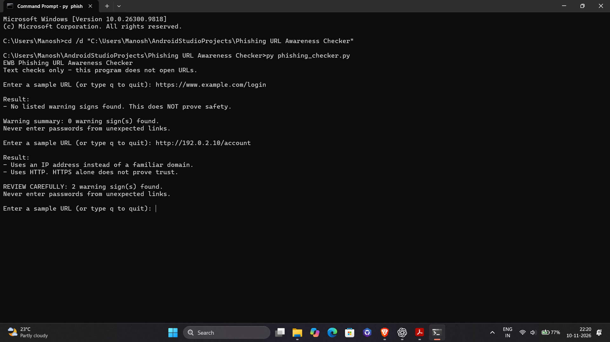
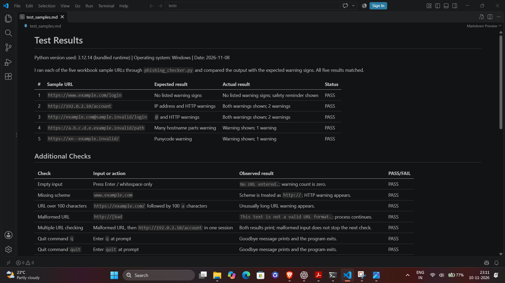

# EWB Phishing URL Awareness Checker

## About this project

I made this small Python program as my cybersecurity internship project. It checks URL text for a few common warning signs and prints what it finds. It is meant for learning about phishing links; it is not a tool that can decide whether a website is safe.

The program only examines the text you enter. It does not open the link, visit a website, or send the URL anywhere.

## What it checks

The checker looks for the warning signs listed in the project workbook:

- An `@` symbol in the URL.
- A URL longer than 100 characters.
- A hostname that looks like an IPv4 address, with four groups of digits separated by dots.
- Five or more hostname parts, such as `a.b.c.d.e.example.invalid`.
- The punycode marker `xn--` in the hostname.
- The `http` scheme.

These are clues to review, not proof that a link is harmful. HTTPS protects the connection, but it does not prove that the website itself is trustworthy. If the checker finds none of these signs, it says so and reminds you that this does not prove safety.

## What I added

I made a few practical improvements while building the checker:

- You can check more than one URL without restarting the program. Type `q`, `quit`, or `exit` when you are finished.
- The program shows a warning count and a `REVIEW CAREFULLY` message when it finds warning signs.
- Empty input and malformed URL text receive a clear message. A malformed URL does not end the session.

The recorded checks for these behaviours are in [`tests/test_samples.md`](tests/test_samples.md).

## What you need

- Python 3.10 or later
- No extra packages; the program uses Python's built-in libraries.

## Run the program

Open PowerShell or Command Prompt in this project folder, then run:

```powershell
python phishing_checker.py
```

If Windows does not recognize `python`, try:

```powershell
py phishing_checker.py
```

On macOS or Linux, use:

```sh
python3 phishing_checker.py
```

Enter a sample URL when prompted. You can enter another one at the next prompt, or type `q`, `quit`, or `exit` to stop. Use the harmless examples from the workbook; do not open links as part of this project.

## Example

Here is the kind of result the program prints for `http://192.0.2.10/account`:

```text
EWB Phishing URL Awareness Checker
Text checks only - this program does not open URLs.

Enter a sample URL (or type q to quit): http://192.0.2.10/account

Result:
- Uses an IP address instead of a familiar domain.
- Uses HTTP. HTTPS alone does not prove trust.

REVIEW CAREFULLY: 2 warning sign(s) found.
Never enter passwords from unexpected links.
```

## Test results

The five workbook samples and their expected and observed results are recorded in [`tests/test_samples.md`](tests/test_samples.md). The table below gives a short summary of those recorded results.

| Sample | Expected result | Recorded result |
|---|---|---|
| `https://www.example.com/login` | No listed signs; safety is not proven | No listed signs; safety reminder shown |
| `http://192.0.2.10/account` | IP-shaped hostname and HTTP warnings | Both warnings shown |
| `http://example.com@sample.invalid/login` | `@` and HTTP warnings | Both warnings shown |
| `https://a.b.c.d.e.example.invalid/path` | Many hostname parts warning | Warning shown |
| `https://xn--example.invalid/` | Punycode warning | Warning shown |

Additional checks for empty input, malformed text, long URLs, repeated checks, and quit commands are also recorded in the test-results file.

## Screenshots

These are the two screenshots requested in the workbook. The first shows the Python program running in Command Prompt. The second shows the five sample test results from `tests/test_samples.md` open in VS Code.





## Limits and safe use

This is a beginner project that checks a short list of URL patterns. It does not visit websites, follow redirects, inspect web pages, check online reputation, detect malware, or prove that a URL is safe. A dangerous link might not match any of the checks, and a legitimate link might match one. **“No listed warning signs found” does not mean a URL is safe.**

The IP-address check follows the workbook's digit-and-dot pattern. It does not check whether each number is in the valid IPv4 range.

Please use the workbook's sample strings or other harmless examples. Do not enter passwords, one-time codes, payment information, or other private details into unexpected links. Do not use the project to test a website without permission, and do not commit passwords, API keys, or other secrets to GitHub.

## Author

- Name: Manosh Chandra Barman
- Project: Cybersecurity Internship, EWB Edutech Private Limited
- GitHub: [manosh7](https://github.com/manosh7)

